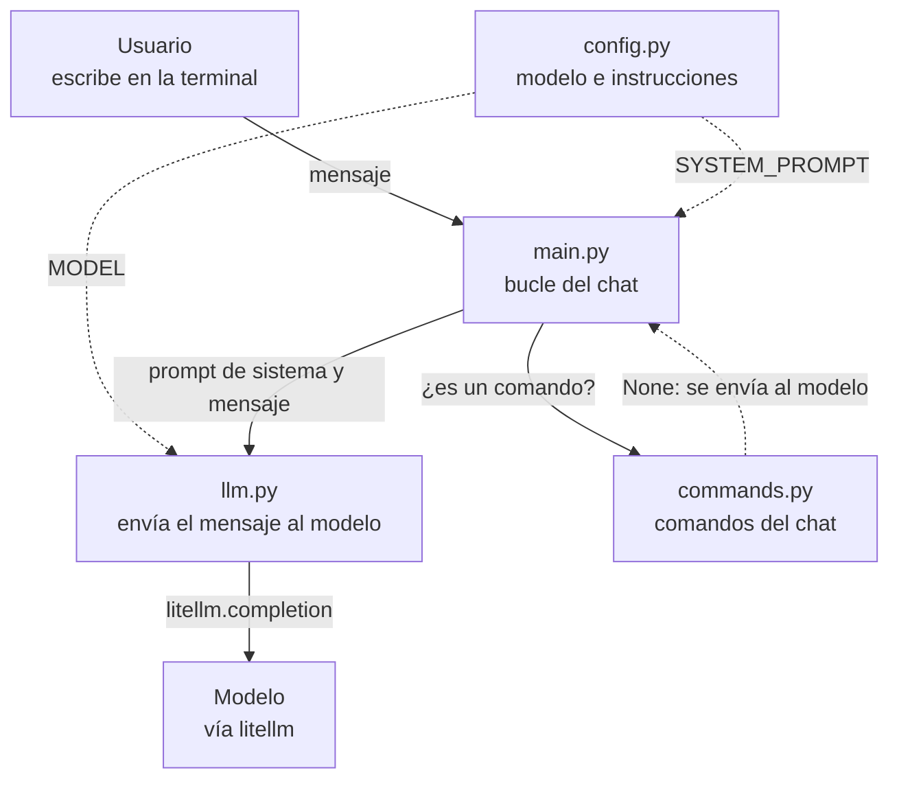

# lagent-v000: conversación sin memoria

> **Punto de partida** · [Índice de la historia](../README.md#cómo-leer-esta-historia) · Anterior: ninguna, este es el punto de partida · Siguiente: [v001, memoria de la conversación](../lagent-v001/README.md)

## En una frase

Armamos lo mínimo para hablar con un modelo desde la terminal: un bucle que lee un mensaje, lo envía con `litellm` y muestra la respuesta.

## El problema que resuelve

Se habla mucho de IA y de agentes, pero pocas veces se muestra cómo construir uno desde cero. Este repositorio busca entender, construyendo, qué separa a una simple llamada a un modelo de lenguaje de un agente. Para eso necesitamos un punto de partida, y la primera pregunta es la más básica: ¿qué es lo mínimo que hace falta para conversar con un modelo desde un programa nuestro?

La respuesta de v000 es un chat en la terminal con comandos básicos. Cada mensaje viaja solo, sin memoria ni contexto. Todavía estamos lejos de un agente, y esa distancia es la que van a recorrer las versiones siguientes. El camino completo está en la [tabla de versiones](../README.md#versiones) y en la [hoja de ruta](../TODO.md).

## Qué hay en esta carpeta

v000 es la primera versión, así que todos los archivos son nuevos.

| Archivo | Responsabilidad | Estado |
| --- | --- | --- |
| `main.py` | El bucle del chat: lee, decide qué hacer con la entrada y muestra la respuesta. | Nuevo |
| `config.py` | El modelo a usar y las instrucciones generales. | Nuevo |
| `llm.py` | Envía el mensaje al modelo con `litellm`. | Nuevo |
| `commands.py` | Atiende los comandos `/exit`, `/quit` y `/help`. | Nuevo |

El programa es corto, pero lo separamos en un archivo por tipo de función. Así se lee con facilidad desde el principio, y a medida que el agente crece se ve en qué archivo aparece cada capacidad nueva. La primera versión de v000 era un único `lagent-v000.py`, y el historial de git conserva ese paso.

## Cómo fluye un mensaje



En verde lo nuevo en esta versión, en amarillo lo modificado. (v000 es el punto de partida, por eso todos los nodos van sin color.)

La respuesta vuelve por el mismo camino: el modelo se la entrega a `llm.py`, `llm.py` a `main.py` y `main.py` la imprime en la terminal.

## Qué cambió respecto de la versión anterior

v000 es el punto de partida y todavía no tenemos otra versión con la cual compararla. En lugar de cambios, recorremos las piezas con las que arrancamos, en el orden en que las toca un mensaje.

### Un bucle que lee la terminal

Todo ocurre dentro de un `while True` en `main.py`. Lo primero es limpiar la entrada, para que un `/exit ` con un espacio al final funcione igual, y descartar los Enter vacíos.

`main.py`:

```python
            # strip() quita espacios sobrantes (por ejemplo "/exit ").
            user_input = input(">>> ").strip()
            # Si el usuario solo presiona Enter, no se envía nada.
            if not user_input:
                continue
```

### Tres respuestas posibles para un comando

Antes de llamar al modelo le preguntamos a `handle_command` si el texto es un comando. La función puede responder tres cosas, y cada una le dice al bucle qué hacer.

`commands.py`:

```python
# Devuelve:
#   - None: el texto no es un comando, hay que enviarlo al modelo.
#   - True: era un comando de salida, hay que terminar el chat.
#   - False: era un comando (o uno desconocido) ya atendido, el chat continúa.
```

Hay una decisión fina en el último caso. Un texto que empieza con `/` y que no reconocemos se trata como un comando mal escrito, y así un error de tipeo se queda en la terminal en vez de llegar al modelo.

`commands.py`:

```python
    # Cualquier otra cosa que empiece con "/" es un comando mal escrito:
    # no se manda al modelo.
    elif command.startswith("/"):
        print(f"Comando desconocido: {command}. Usa /help.")
        return False
```

### La llamada al modelo

`llm.py` tiene una sola función, `send_message`, y habla con el modelo a través de `litellm`. Elegimos esta biblioteca porque da acceso a cualquier proveedor con la misma llamada, desde los más conocidos hasta un modelo local. Así no gastamos tiempo en integraciones propias de cada proveedor, y el agente funciona en cualquier lado.

Para el modelo, una conversación es una lista de mensajes con un rol. En v000 esa lista siempre tiene dos elementos: las instrucciones y lo que acaba de escribir la persona.

`llm.py`:

```python
        # La conversación es una lista de mensajes, cada uno con un rol:
        # "system" para las instrucciones y "user" para lo que escribe la persona.
        messages=[
            {
                "role": "system",
                "content": system_prompt
            },
            {
                "role": "user",
                "content": user_message
            },
        ],
```

Esa lista explica por qué el chat no recuerda nada: se arma desde cero en cada llamada y nada de lo anterior entra en ella.

### Un error nunca es una respuesta

`send_message` deja pasar las excepciones. El motivo está en su comentario: quien llama decide qué hacer, y así un fallo de red o una clave inválida no se confunde con algo que dijo el modelo.

`llm.py`:

```python
# Si algo falla (red, clave inválida, etc.) lanza la excepción: quien la llama decide
# qué hacer, así un error nunca se confunde con una respuesta del modelo.
```

`main.py` recoge esa decisión con un `try` alrededor de la llamada. El chat muestra el error y sigue esperando el próximo mensaje.

`main.py`:

```python
            try:
                print(send_message(SYSTEM_PROMPT, user_input))
            except Exception as e:
                print(f"Error: {e}")
```

Un segundo `try`, que envuelve todo el bucle, atiende `Ctrl+C` y `Ctrl+D` para salir de forma ordenada.

### La configuración queda fuera de la lógica

`config.py` guarda el modelo y las instrucciones. El modelo se puede cambiar con la variable de entorno `MODEL` sin tocar el código.

`config.py`:

```python
MODEL = os.environ.get("MODEL", "anthropic/claude-haiku-5-5")
```

Elegimos `anthropic/claude-haiku-5-5` como valor por defecto porque es el modelo más económico de la familia Claude y tiene buena relación entre calidad y precio.

La clave de la API y la URL base también vienen de variables de entorno, para no dejar datos sensibles escritos en el código. Esas dos las lee `llm.py`, que es quien las usa.

## Cómo probarlo

Necesitamos Python y `litellm`, que se instala con `pip install -r requirements.txt` desde la raíz del repositorio. También las variables de entorno del proveedor. `BASE_URL` es opcional con Anthropic, OpenAI y OpenRouter, y la sección [Conectarse a un proveedor](../README.md#conectarse-a-un-proveedor) del README raíz tiene un ejemplo para cada uno.

```bash
export API_KEY="tu-clave"
export BASE_URL="https://tu-endpoint"   # opcional con OpenAI, Anthropic y OpenRouter
cd lagent-v000
python main.py
```

Los comandos funcionan sin llamar al modelo. Si escribimos `/help` y luego `/hola`, deberíamos ver esto:

```text
>>> /help
Comandos disponibles:
/exit o /quit: Salir del chat.
/help: Mostrar esta ayuda.
>>> /hola
Comando desconocido: /hola. Usa /help.
```

Como no hay versión anterior, la prueba interesante es la que deja a la vista la limitación. Enviamos estos dos mensajes seguidos:

```text
>>> Me llamo Ana
>>> ¿Cómo me llamo?
```

La segunda llamada lleva solo el prompt de sistema y `¿Cómo me llamo?`, así que el modelo no tiene de dónde sacar el nombre. Vamos a repetir esta misma prueba en [v001](../lagent-v001/README.md#cómo-probarlo) para ver la diferencia.

## Lo que todavía falta

El modelo no recuerda nada. Cada mensaje es independiente, así que no se puede sostener una conversación ni retomarla después, porque nada queda guardado. También hay un detalle menor: si el modelo devuelve un contenido vacío, `print` muestra `None` en pantalla, porque todavía no tratamos ese caso.

[v001](../lagent-v001/README.md) ataca la falta de memoria y abre el primer arco de la historia, el [arco de la memoria](../README.md#arco-1-memoria).

---

> **Punto de partida** · [Índice de la historia](../README.md#cómo-leer-esta-historia) · Siguiente: [v001, memoria de la conversación](../lagent-v001/README.md)
