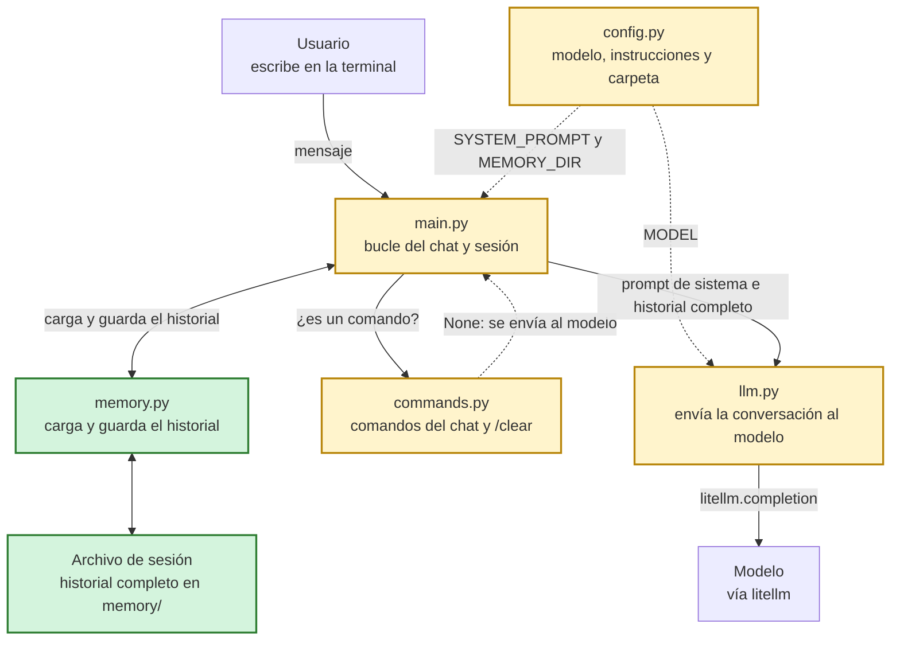

# lagent-v001: memoria de la conversación

> **Arco 1: memoria**, capítulo 1 de 3 · [Índice de la historia](../README.md#cómo-leer-esta-historia) · Anterior: [v000, conversación sin memoria](../lagent-v000/README.md) · Siguiente: [v002, ventana de memoria](../lagent-v002/README.md)

## En una frase

Agregamos memoria: el historial se guarda en una variable y en un archivo, así el modelo recuerda lo anterior y la conversación sobrevive entre sesiones.

## El problema que resuelve

En [v000](../lagent-v000/README.md) cada mensaje viajaba solo. Si escribíamos "Me llamo Ana" y después preguntábamos "¿Cómo me llamo?", la segunda llamada llevaba únicamente esa pregunta y el modelo no tenía de dónde sacar el nombre. Tampoco se podía retomar una conversación, porque nada quedaba guardado.

La clave para entender esta versión es que el modelo no guarda nada entre llamadas. Para que "recuerde", tenemos que enviarle toda la conversación cada vez.

Con esta versión empieza el [arco de la memoria](../README.md#arco-1-memoria). Sus tres capítulos persiguen la misma meta: que el agente recuerde la conversación con un costo acotado. v001 consigue que recuerde, y los dos capítulos siguientes se ocupan del costo.

## Qué hay en esta carpeta

| Archivo | Responsabilidad | Estado |
| --- | --- | --- |
| `main.py` | El bucle del chat. Ahora elige la sesión, mantiene el historial y lo guarda después de cada intercambio. | Modificado |
| `memory.py` | Carga y guarda el historial de cada sesión en un archivo. | Nuevo |
| `llm.py` | Envía la conversación completa al modelo y devuelve también el uso de tokens. | Modificado |
| `config.py` | Suma la carpeta de sesiones a lo que ya tenía. | Modificado |
| `commands.py` | Suma el comando `/clear`. | Modificado |
| `memory/` | Carpeta de las sesiones. Trae un `.fakeignore` vacío: el `.gitignore` excluye las sesiones pero deja pasar ese archivo, y así la carpeta queda en el repositorio. | Nuevo |

## Cómo fluye un mensaje



En verde lo nuevo en esta versión, en amarillo lo modificado.

## Qué cambió respecto de v000

### La conversación pasa a ser una lista

El cambio central ocupa pocas líneas. `send_message` deja de recibir un mensaje suelto y recibe el historial completo. El prompt de sistema se agrega al principio de cada llamada y no se guarda en el historial.

`llm.py`:

```python
        messages=[
            {
                "role": "system",
                "content": system_prompt
            }
            ] + messages,
```

Ahora esa lista crece con la conversación. El historial vive en `main.py`, en una variable que se llama igual, y es la memoria del agente.

`main.py`:

```python
    # Memoria: lista con todos los mensajes de la conversación, en orden.
    # Cada elemento es {"role": "user" | "assistant", "content": texto}.
    messages = load_memory(memory_path)
```

### Qué entra a la memoria y cuándo

Con una lista que se reenvía entera, un mensaje malo nos acompaña para siempre. Por eso casi todo el bucle nuevo se dedica a cuidar qué entra.

El mensaje del usuario se agrega antes de llamar al modelo, para que viaje junto con lo anterior. Si la llamada falla, lo sacamos, y así podemos reintentar sin duplicarlo.

`main.py`:

```python
            try:
                reply, usage = send_message(SYSTEM_PROMPT, messages)
            except Exception as e:
                # El error se muestra en pantalla pero no entra a la memoria: se quita
                # también el mensaje del usuario para poder reintentar sin duplicarlo.
                messages.pop()
                print(f"Error: {e}")
                continue
```

Una respuesta vacía recibe el mismo trato. El comentario explica el riesgo: ese mensaje vacío se reenviaría en cada pregunta siguiente. Es una protección preventiva, para un caso que todavía no hemos visto ocurrir.

`main.py`:

```python
            # Una respuesta vacía no se guarda: un mensaje vacío en el historial se
            # reenviaría en cada pregunta siguiente y la API podría rechazarlo, dejando
            # la sesión inutilizable. Se avisa y se quita el mensaje del usuario para reintentar.
            if not reply:
                messages.pop()
                print("El modelo devolvió una respuesta vacía. Intenta de nuevo.")
                continue
```

### Tokens a la vista, fuera del try

Antes de cada respuesta mostramos cuántos tokens enviamos. Es lo que se cobra y crece con el historial, así que hace visible el precio de recordar. La cifra es de referencia. La medición completa, con los tokens de la respuesta y el costo de cada llamada, está en los [benchmarks](../bench/README.md).

Vale la pena mirar dónde está este código. Si estuviera dentro del `try` de la llamada, un problema al leer el contador activaría el `except`, que descarta el intercambio, y perderíamos una respuesta que el modelo ya generó y que ya se cobró.

`main.py`:

```python
            # Mostramos los tokens enviados, que crecen con el historial y es lo que se cobra.
            # Va fuera del try anterior a propósito: ese except descarta la respuesta, y un
            # contador incompleto no debe tirar una respuesta que el modelo ya generó (y que
            # ya se cobró). Por eso se lee con getattr y se muestra solo si existe.
            prompt_tokens = getattr(usage, "prompt_tokens", None)
            if prompt_tokens is not None:
                print(f"[tokens enviados: {prompt_tokens}]")
```

### Guardar en disco sin perder la respuesta

Guardamos después de cada intercambio, por si el programa se corta. Esto también lleva su propio `try`, con la misma lógica: si el disco falla, la respuesta sigue siendo válida. La conservamos en la memoria en RAM y solo avisamos.

`main.py`:

```python
            # Se guarda en el archivo después de cada intercambio por si el programa se corta.
            # Va en su propio try: si falla el guardado la respuesta ya es válida, así que
            # se conserva en la memoria en RAM y solo se avisa (no se deshace nada).
            try:
                save_memory(memory_path, messages)
            except OSError as e:
                print(f"No se pudo guardar la sesión: {e}")
```

El guardado en sí escribe primero en un archivo temporal y después lo reemplaza. Así, un corte en plena escritura deja intacto el archivo anterior.

`memory.py`:

```python
    tmp_path = path + ".tmp"
    with open(tmp_path, "w", encoding="utf-8") as f:
        json.dump(messages, f, ensure_ascii=False, indent=2)
    os.replace(tmp_path, path)
```

Al cargar, un archivo dañado o que no contiene una lista se avisa en pantalla y el chat arranca con la memoria vacía.

### Una sesión por archivo

El primer argumento elige la sesión, y cada sesión es un archivo `memory/<nombre>.json`. Guardamos en JSON porque conserva la estructura de la lista de mensajes. Un texto libre, como markdown, habría que interpretarlo para recuperar cada mensaje. Con JSON el historial se carga directo como lista, y también se puede llevar sin esfuerzo a una base de datos u otro medio.

Como el nombre de la sesión termina formando una ruta, lo validamos. La decisión está en el comentario: rechazamos el nombre en lugar de limpiarlo, para que un `../x` no se transforme en silencio en otro archivo.

`main.py`:

```python
    # Se rechaza en vez de "limpiarlo": así un nombre con "/" o ".." no se transforma
    # en silencio en otro archivo, y no hay forma de salirse de la carpeta memory/.
    session = sys.argv[1] if len(sys.argv) > 1 else "default"
    if not re.fullmatch(r"[A-Za-z0-9_-]+", session):
        sys.exit("Nombre de sesión inválido: usa solo letras, números, '-' y '_'.")
```

La carpeta se calcula a partir de la ubicación de `config.py`, para que quede junto al código sin importar desde dónde ejecutemos el programa.

`config.py`:

```python
MEMORY_DIR = os.path.join(os.path.dirname(os.path.abspath(__file__)), "memory")
```

### Un comando para vaciar la memoria

Como ahora hay algo que recordar, también necesitamos poder borrarlo. `/clear` vacía la variable y el archivo, y por eso `handle_command` recibe ahora el historial y la ruta de la sesión.

`commands.py`:

```python
    elif command == "/clear":
        messages.clear()
        save_memory(memory_path, messages)
        print("Memoria borrada.")
        return False
```

## Cómo probarlo

Con las mismas variables de entorno de v000 (ver [Conectarse a un proveedor](../README.md#conectarse-a-un-proveedor)), repetimos la [prueba de esa versión](../lagent-v000/README.md#cómo-probarlo):

```bash
cd lagent-v001
python main.py pruebas
```

```text
Sesión 'pruebas' (0 mensajes en memoria). Usa /help para ver los comandos.
>>> Me llamo Ana
>>> ¿Cómo me llamo?
```

Esta es la diferencia con v000: la segunda llamada lleva cuatro mensajes (sistema, usuario, asistente, usuario), así que el modelo tiene el nombre a la vista y puede responder. Antes de cada respuesta aparece una línea `[tokens enviados: N]`, si el proveedor informa el dato, y el número sube de una respuesta a la siguiente.

Para comprobar que la conversación sobrevive, salimos con `/exit` y volvemos a abrir la misma sesión:

```text
Sesión 'pruebas' (4 mensajes en memoria). Usa /help para ver los comandos.
```

El archivo está en `memory/pruebas.json`. Con `/clear` queda como una lista vacía. Y un nombre inválido se rechaza al arrancar:

```bash
python main.py ../x
```

```text
Nombre de sesión inválido: usa solo letras, números, '-' y '_'.
```

## Lo que todavía falta

Este sistema de memoria es ineficiente. Enviamos el historial completo en cada mensaje y solo se vacía a mano con `/clear`. La memoria crece sin límite, así que cada mensaje lleva más contexto que el anterior. Como las APIs cobran por los tokens enviados, el costo de cada respuesta aumenta con la sesión, y tarde o temprano se puede superar el límite de contexto del modelo.

Los [benchmarks](../bench/README.md) miden ese crecimiento en una conversación de 100 mensajes.

[v002](../lagent-v002/README.md) ataca este problema: el historial crece sin límite.

---

> **Arco 1: memoria**, capítulo 1 de 3 · [Índice de la historia](../README.md#cómo-leer-esta-historia) · Anterior: [v000, conversación sin memoria](../lagent-v000/README.md) · Siguiente: [v002, ventana de memoria](../lagent-v002/README.md)
