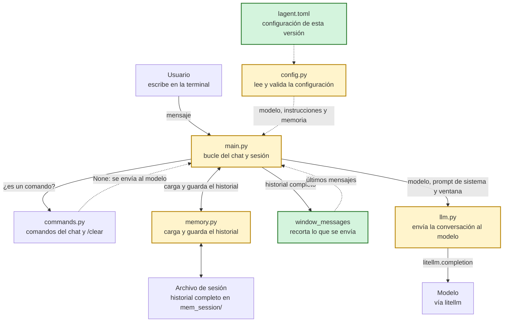

# lagent-v002: ventana de memoria

## En una frase

Agregamos una ventana: guardamos en disco el historial completo, enviamos al modelo solo los últimos mensajes y pasamos la configuración a `lagent.toml`.

## El problema que resuelve

En v001 enviábamos el historial completo en cada mensaje. Eso le daba memoria al modelo, pero también hacía que cada mensaje costara más que el anterior, porque las APIs cobran por los tokens enviados. Con el tiempo se podía superar el límite de contexto del modelo. La única forma de frenarlo era `/clear`, que dependía de que alguien se acordara de usarlo.

La pregunta de esta versión es cómo evitar que lo enviado crezca sin límite, sin borrar la conversación guardada.

## Qué hay en esta carpeta

| Archivo | Responsabilidad | Estado |
| --- | --- | --- |
| `memory.py` | Carga y guarda el historial. Ahora también calcula la ventana. | Modificado |
| `main.py` | El bucle del chat. Lee la configuración al arrancar y envía solo la ventana. | Modificado |
| `lagent.toml` | La configuración de esta versión: modelo, instrucciones y memoria. | Nuevo |
| `config.py` | Lee y valida `lagent.toml`. | Modificado |
| `llm.py` | Envía la conversación al modelo. Ahora recibe el modelo como argumento. | Modificado |
| `commands.py` | Comandos del chat. | Sin cambios |
| `memory/` | Carpeta heredada de v001. Esta versión guarda en `mem_session/`, que se crea con el primer guardado. | Sin cambios |

## Cómo fluye un mensaje



En verde lo nuevo en esta versión, en amarillo lo modificado.

## Qué cambió respecto de v001

### Memoria guardada y memoria enviada

La idea central de esta versión es que lo que guardamos y lo que enviamos pueden ser cosas distintas. El archivo de la sesión sigue teniendo todo, pero el modelo recibe un recorte que calculamos justo antes de llamarlo.

`main.py`:

```python
                sent = window_messages(messages, window)
                reply, usage = send_message(model, system_prompt, sent)
```

La variable `messages` no se toca, así que el guardado funciona igual que antes y el archivo conserva toda la conversación.

### Una ventana que empieza en una pregunta

La función nueva toma los últimos `window` mensajes y hace un ajuste importante. Si el corte cae en una respuesta del modelo, también la descarta, porque su pregunta quedó fuera de la ventana. Así, el modelo nunca recibe una respuesta sin su pregunta.

`memory.py`:

```python
def window_messages(messages, window):
    recent = messages[-window:]
    while recent and recent[0]["role"] != "user":
        recent = recent[1:]
    return recent
```

Este ajuste tiene una consecuencia visible: a veces enviamos un mensaje menos que `window`. En un chat normal los mensajes se alternan y el último siempre es del usuario, así que con `window = 8` los últimos ocho empiezan en una respuesta y se envían 7.

### Un indicador para ver el recorte

El indicador de v001 mostraba solo tokens. Ahora también dice cuántos mensajes del total se enviaron, y por eso lo armamos por partes: la cantidad de mensajes siempre está disponible, mientras que los tokens dependen del proveedor.

`main.py`:

```python
            sent_info = f"mensajes enviados: {len(sent)} de {len(messages)}"
            if prompt_tokens is not None:
                sent_info += f", tokens enviados: {prompt_tokens}"
            print(f"[{sent_info}]")
```

### La configuración sale del código

Con un parámetro nuevo que ajustar, pasamos la configuración a un archivo. Cada versión tiene el suyo junto a su código. El archivo incluye también, comentadas, claves de versiones futuras.

`lagent.toml`:

```toml
model = "anthropic/claude-haiku-5-5"
system_prompt = "Eres un asistente útil."

[memory]
dir = "mem_session"              # carpeta de las sesiones
window = 8                 # v002: mensajes que se envían al modelo
```

`API_KEY` y `BASE_URL` siguen en variables de entorno, para que este archivo se pueda versionar sin datos sensibles. La variable `MODEL` conserva su lugar y tiene prioridad sobre el archivo. Por eso se aplica antes de validar: `model` puede faltar en el archivo si la variable está definida.

`config.py`:

```python
    if "MODEL" in os.environ:
        config["model"] = os.environ["MODEL"]
    validate_config(config)
```

### Validar al arrancar

`config.py` deja de tener valores por defecto. Si falta una clave o tiene un valor no válido, preferimos enterarnos al arrancar en vez de fallar más tarde en medio del chat.

`window` muestra por qué esta validación vale la pena. Un `0` parece una ventana vacía, pero en Python `messages[-0:]` devuelve la lista completa, así que enviaríamos todo el historial sin ningún aviso. También hay un detalle de Python en el uso de `type()`: `isinstance(True, int)` es verdadero, y con esa comprobación `window = true` pasaría como un número.

`config.py`:

```python
    # Sin esta validación window = 0 no daría error: messages[-0:] es la lista completa
    # y se enviaría todo el historial. Se usa type() porque True también es un int.
    if type(memory.get("window")) is not int or memory["window"] < 1:
        raise ValueError("memory.window debe ser un entero mayor que 0.")
```

`main.py` convierte cualquier problema de configuración en un mensaje claro y termina. Un error de sintaxis del TOML cae en el mismo `except` que un valor inválido, porque `TOMLDecodeError` es un tipo de `ValueError`.

`main.py`:

```python
    try:
        config = load_config()
    except OSError as e:
        sys.exit(f"No se pudo leer lagent.toml: {e}")
    except ValueError as e:
        sys.exit(f"Error en lagent.toml: {e}")
```

### Cambios menores que acompañan

Como la configuración ahora se carga con una función, `llm.py` deja de importar el modelo desde `config.py` y lo recibe como argumento de `send_message`. Las sesiones pasan a guardarse en la carpeta que indica `memory.dir`. Con el valor actual es `mem_session/`, relativa a la carpeta de la versión, aunque también acepta una ruta absoluta. El formato del archivo de sesión es el mismo de v001.

## Cómo probarlo

Con las mismas variables de entorno de siempre:

```bash
cd lagent-v002
python main.py pruebas
```

Si enviamos seis mensajes seguidos, con `window = 8`, el indicador debería mostrar esta secuencia. Además aparecen los tokens, si el proveedor los informa:

```text
[mensajes enviados: 1 de 1]
[mensajes enviados: 3 de 3]
[mensajes enviados: 5 de 5]
[mensajes enviados: 7 de 7]
[mensajes enviados: 7 de 9]
[mensajes enviados: 7 de 11]
```

Lo enviado se detiene en 7, mientras el total sigue creciendo. El archivo `mem_session/pruebas.json` conserva todos los mensajes.

Para ver la limitación, escribimos "Me llamo Ana" como primer mensaje y preguntamos "¿Cómo me llamo?" en el quinto. A esa altura el primer mensaje ya salió de la ventana y el modelo no lo recibe.

Para ver la diferencia con v001 en la misma conversación, copiamos una sesión, porque ambas versiones usan el mismo formato. Desde la raíz del repositorio:

```bash
mkdir -p lagent-v002/mem_session
cp lagent-v001/memory/pruebas.json lagent-v002/mem_session/pruebas.json
```

Después ejecutamos `python main.py pruebas` en la carpeta de cada versión y enviamos el mismo mensaje. La diferencia de tokens muestra lo que ahorra la ventana.

Por último, podemos comprobar la validación cambiando el archivo a `window = 0`:

```text
Error en lagent.toml: memory.window debe ser un entero mayor que 0.
```

## Lo que todavía falta

El modelo olvida de golpe. Lo que queda fuera de la ventana desaparece por completo para él, aunque siga en el archivo. Un dato importante dicho al principio, como un nombre o una decisión, se pierde sin aviso, y el modelo puede contradecirlo o inventar otro.

Además, la ventana cuenta mensajes y no tokens. Unos pocos mensajes muy largos todavía pueden costar mucho o superar el límite de contexto.

v003 ataca estos dos puntos.

## Preguntas para el autor

- ¿Por qué `window = 8`? ¿Probaste otros valores?
- ¿Por qué el nombre `mem_session/` para reemplazar a `memory/`? El código solo muestra el cambio de carpeta.
- `lagent-v002/memory/` sigue en la carpeta con su `.fakeignore`, aunque esta versión guarda en `mem_session/`. ¿Es intencional o conviene limpiarlo? Allí hay además un `default.json` local, ignorado por git, que esta versión no lee.
- ¿Por qué `llm.py` recibe el modelo como argumento en lugar de leerlo de la configuración? ¿Fue una consecuencia de pasar a `load_config()` o una decisión de diseño?
- ¿Por qué TOML y por qué sin valores por defecto en el código?
- ¿Por qué incluir en el archivo las claves comentadas de versiones futuras?
- ¿Tienes un caso real en que el modelo haya olvidado un dato por la ventana, o una medición real del ahorro frente a v001? La tabla del README raíz es simulada.
